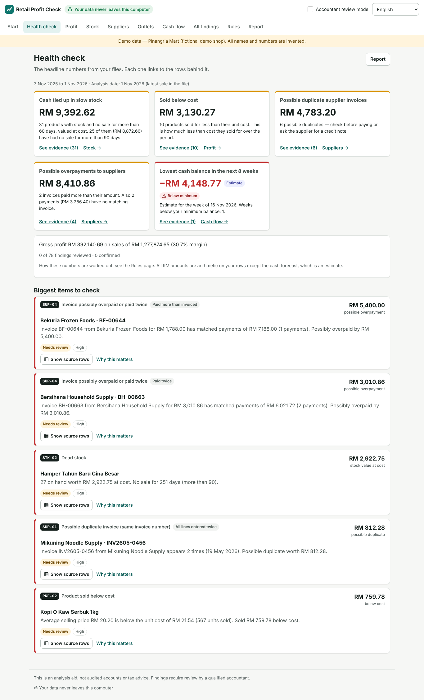
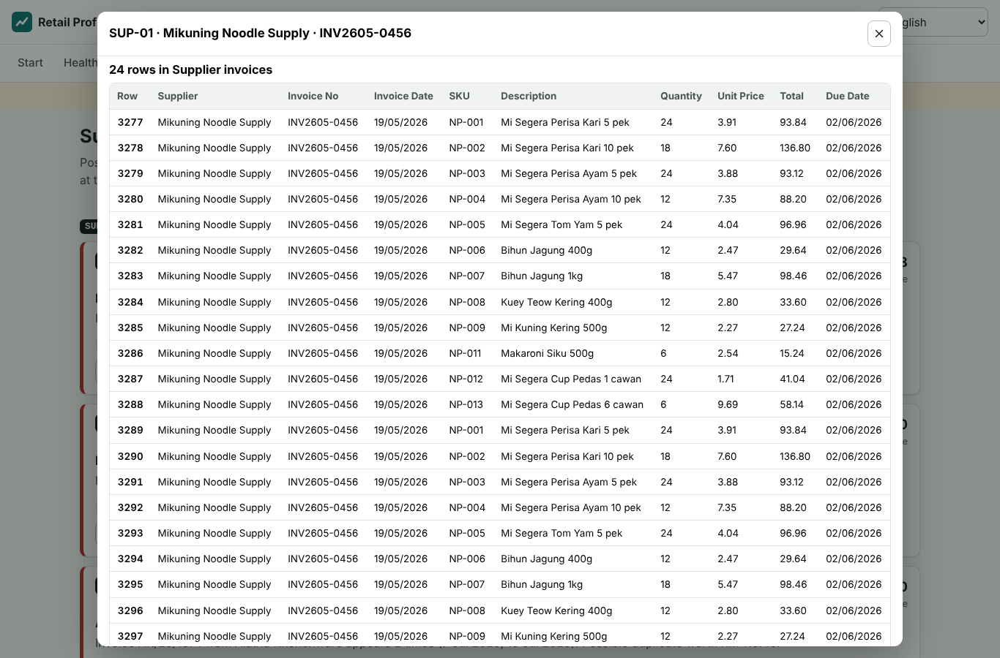
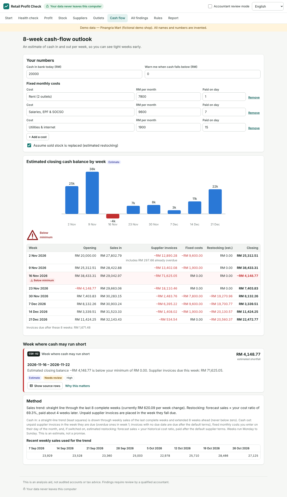
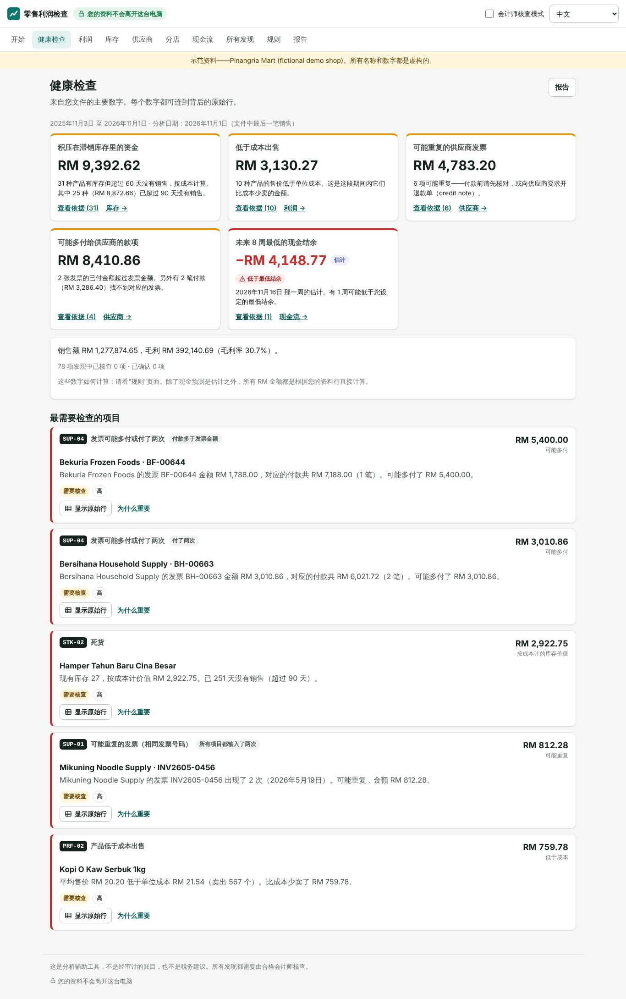

# Retail Profit Check

A browser-only **profit, stock, supplier-invoice and cash-flow health check** for Malaysian retail SMEs. An owner loads their sales export, product/stock list, supplier invoices and (optionally) payments. The app runs plain-English, editable rules and shows every finding with the exact rows behind it, so a qualified accountant can review it.

> **Your data never leaves this computer.** Files are read and analysed inside the browser tab. There is no server, no upload, no tracking and no AI service. The built site carries a Content-Security-Policy with `connect-src 'none'`, so the page cannot open a network connection at all.
>
> **This is an analysis aid, not audited accounts or tax advice. Findings require review by a qualified accountant.**

This repository is a **sales and pilot tool** for owner interviews and two paid pilots, not the final product. Demand has not been proven yet.

| | |
|---|---|
|  |  |
|  |  |

More screenshots: [`docs/screenshots/`](docs/screenshots/).

## Run it

Requires Node.js 20+ (tested on 22).

```bash
npm install
```

```bash
npm run dev
```

Then open the address it prints and click **Load demo data**.

### Build a static site

```bash
npm run build
```

`dist/` can be put on any static web host or served locally:

```bash
npm run preview
```

### Open it without a server (double-click)

```bash
npm run build:offline
```

Then double-click `dist-offline/index.html`. This build runs the analysis on the page instead of in a Web Worker (browsers do not allow workers or module scripts on `file://`).

Do not deploy it publicly with real customer data in mind: it is meant to run on the owner's or accountant's own computer.

## Use it

1. **Start** — click **Load demo data**, or add your own files. Blank CSV templates are on each card. Column names in English, Bahasa Melayu or 中文 are recognised; fix any column in the mapping table. Your choice is remembered for files with the same layout. Rows that cannot be read are listed with their spreadsheet row numbers.
2. **Health check** — five headline RM numbers: cash tied up in slow stock, sales below cost, possible duplicate supplier invoices, possible overpayments, and the lowest cash week in the next 8 weeks (an estimate). **See evidence** opens the findings behind each number.
3. **Profit / Stock / Suppliers / Outlets / Cash flow** — the detail. On every finding, **Show source rows** shows the original rows from your files; **Why this matters** explains the rule. On **Cash flow**, enter cash in bank and fixed monthly costs (rent, salaries, utilities).
4. **Rules** — every rule in plain language, with editable thresholds (target margin 25%, dead stock 90 days, duplicate window 7 days, price rise 5%, …). Changing a number re-runs the analysis.
5. **Accountant review mode** (top bar) — mark each finding *Confirmed*, *Not an issue* or *Needs info*, with a note.
6. **Report** — a one-page owner summary (print or save as PDF), then an appendix of every finding with its rows and review status. Findings can be downloaded as CSV or Excel for the accountant.
7. Switch language (English / 中文 / Bahasa Melayu) at the top right.

## What it checks

All thresholds live in one file: [`src/rules/rules.config.ts`](src/rules/rules.config.ts).

| Rule | Check |
|---|---|
| PRF-01 | How profit is calculated (revenue after discounts and refunds − units × unit cost) |
| PRF-02 | Product sold below cost (average net price < unit cost) |
| PRF-03 | Gross margin below target (default 25%) |
| STK-01 | Stock value by days since last sale (0–30, 31–60, 61–90, 91–180, 180+) |
| STK-02 | Dead stock: no sale for more than 90 days |
| STK-03 | Slow stock: no sale for more than 60 days (not yet dead) |
| STK-04 | Days of stock cover (on hand ÷ average daily units over 90 days) |
| SUP-01 | Possible duplicate invoice: same supplier + same invoice number |
| SUP-02 | Possible duplicate invoice: same supplier + same amount within 7 days |
| SUP-03 | Supplier unit price up more than 5% on the previous price |
| SUP-04 | Invoice possibly overpaid or paid twice (needs payments file) |
| SUP-05 | Payment with no matching invoice (needs payments file) |
| CSH-01 | How the 8-week cash outlook is estimated (stated on the page) |
| CSH-02 | Week where the estimated closing balance falls below your minimum |

Wording is deliberate: "possible duplicate", "needs review", "estimate". RM amounts are arithmetic on your rows, except the cash forecast.

## What it does not do

It does not replace an accountant, produce audited accounts or give tax advice; it does not connect to POS or accounting systems; it does not store anything on a server; and its forecast is a simple trend, not a prediction. See **[docs/LIMITATIONS.md](docs/LIMITATIONS.md)**.

## Demo data

`Load demo data` generates a **fictional** two-outlet Penang minimart ("Pinangria Mart") in the browser: 52 weeks (3 Nov 2025 – 1 Nov 2026), 252 SKUs, 30 suppliers with coined names, ~84,000 sales lines with weekday/weekend, year-end, Chinese New Year and Hari Raya patterns. Known problems are planted: 6 duplicate invoices, 10 below-cost products, 25 dead-stock SKUs, 4 supplier price jumps, 2 overpayments, 2 payments with no invoice and 1 cash-crunch week. The answer key, with an accuracy table regenerated from the analyses, is in **[demo/ANSWER_KEY.md](demo/ANSWER_KEY.md)**; the same files as CSV are in `demo/data/` for trying the upload flow (`npm run demo:export` regenerates them).

## Tests

| Command | What |
|---|---|
| `npm test` | 225 unit, accuracy and performance tests (Vitest) |
| `npm run test:accuracy` | Analyses on the demo data vs the answer key, with a false-positive report |
| `npm run test:perf` | 100,000 sales rows end to end |
| `npm run test:coverage` | Coverage of the non-UI code (≈94% statements) |
| `npm run test:e2e` | 17 Playwright tests (demo journey, every page, evidence, languages, review mode, print/PDF, uploads, XSS, 100k-row upload, offline build); screenshots go to `docs/screenshots/` |
| `npm run lint` / `npm run typecheck` | ESLint (bans `dangerouslySetInnerHTML`) and TypeScript strict |
| `npm run verify` | All of the above |

## Project layout

```
src/core       file reading (CSV, XLSX), column mapping, validation, templates, safe CSV export
src/rules      rules.config.ts (every rule and threshold), settings
src/analysis   profit, stock, suppliers, cash flow, health-check summary (pure functions)
src/demo       seeded synthetic data generator with planted issues, accuracy check
src/worker     Web Worker engine (+ on-page fallback)
src/i18n       English, 中文, Bahasa Melayu
src/ui         React pages and components
tests/         unit, accuracy, perf      e2e/   Playwright
sales-kit/     offer, interview script, WhatsApp messages, objections, pilot agreement draft, demo script (EN + 中文)
marketing/     landing page, demo videos, 30-day social calendar, ads + RM500 test plan, lead tracking (see marketing/README.md)
research/      synthetic objection rehearsal — NOT market validation
docs/          PLAN, PROGRESS, DECISIONS, LIMITATIONS, screenshots
.claude/       selected ECC agents, skills and rules used to build this (no hooks)
```

## Privacy and security notes

- Only settings, column mappings and review notes are kept, in the browser's localStorage; **Clear data and remembered settings** on the Start page removes them.
- File contents are only ever rendered as text (React escaping; no `innerHTML`), long cells are capped, and crafted files (zip bombs, huge rows, slow-regex strings) are refused or capped.
- Exported CSV/Excel cells that start with `=`, `+`, `-`, `@`, tab or CR are prefixed with `'` so spreadsheets do not run them as formulas.
- For pilots, keep owners' files on an encrypted laptop and delete them after the pilot (see `sales-kit/05-pilot-agreement-draft.en.md`, a draft that must be reviewed by a lawyer).

## Licence and credits

Built with React, Vite, PapaParse, read-excel-file and write-excel-file. The `.claude/` folder contains files from [ECC](https://github.com/affaan-m/ECC) (MIT, see `.claude/ECC-LICENSE`). Demo data, names and figures are invented.
